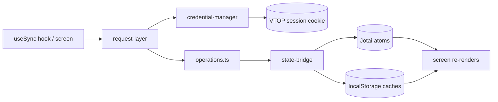

# The Sync Engine

> **In one line:** the only module allowed to talk to AmazeCC-API — it owns VTOP credentials,
> requests, retries, and the fan-out of replies into UI state.

Reading order (each page = one module):

Modules in dependency order (the page list below follows the same order):

- **01-overview.md** — what the engine is and why raw `fetch` doesn't exist in this repo
- **02-request-layer.md** — `apiRequest()`: auth, dedupe, retry, cancellation
- **03-credential-manager.md** — VTOP session lifecycle, single-flight logins, backoff
- **04-operations-catalog.md** — every op, its payload, what it writes
- **05-sync-modes.md** / **06-sync-modes-editor.md** — presets & custom runs
- **07-state-bridge.md** — `state-bridge.ts`: atoms + caches, always both
- **08-progress-bus-and-useSync.md** — the event bus and the hook surface
- **09-error-taxonomy.md** — `AuthError` vs `TransientError`; retry matrix
- **10-demo-mode.md** — full no-network operation
- **11-marks-sync-privacy.md** — the consented "share your marks for class stats" subsystem
- **12-unicc-fallback.md** / **13-failover-and-backup-api.md** — the failure ordering, and why UniCC is*scoped*
- **14-api-route-contracts.md** — exact shapes; test fixtures are the source
- **15-rate-limit-and-captcha.md** — why logins cost seconds and how single-flight saves them
- **16-adapters.md** — unified `/grades` and FFCS payload shaping

Legacy copies of portions of these docs live in `docs/sync-engine/` (kept for history). The
pages here are authoritative; they were written against the code, line by line.
